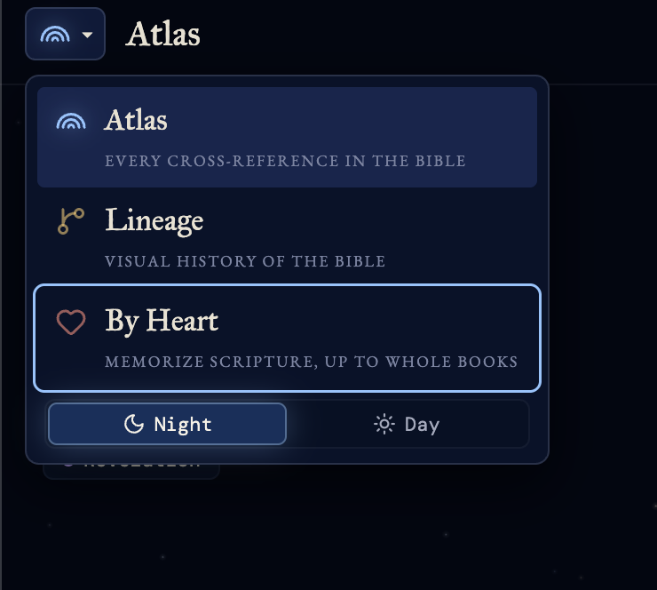

# bible

> *Three ways into one book: see how it speaks to itself, who lived it, and carry it with you.*

A family of free, open-source apps for reading and studying the Bible. Each one takes a single idea and gives it a whole screen. Atlas and Lineage share one design system, so moving between them feels like turning pages in the same book, and one app switcher links all three.

**▶ [Open Atlas](https://jessedestroys.com/bible/atlas/)** · **[Open Lineage](https://jessedestroys.com/bible/lineage/)** · **[Open By Heart](https://jessedestroys.com/bible/byheart/)**

## The apps

### 🌈 Atlas: every cross-reference at once

*344,799 threads woven through 66 books.*

The small notes in a Bible's margin send you from one passage to another that echoes, quotes or fulfills it. On paper you follow them one at a time. Atlas draws all of them together: 31,102 verses on one line from Genesis to Revelation, with every cross-reference an arc above it. Inspired by [Chris Harrison's](https://www.chrisharrison.net/index.php/visualizations/BibleViz) arc diagram.

- **Read both ends of a connection.** Tap an arc and both passages open side by side, with the reader votes behind the link.
- **Follow a passage outward.** Pick a verse, chapter or book to bring its arcs forward, split into what it references and what references it.
- **Two more ways to see it.** A 66×66 heatmap of which books lean on each other, and a spiral galaxy where every verse is a star.
- **Search, filter, shuffle.** Jump to `John 3:16` or `1 cor 13:4-7`, filter by section or reader votes, or land on a random connection.

**▶ [Open Atlas](https://jessedestroys.com/bible/atlas/)** · [More about Atlas →](apps/atlas/README.md)

### 🌿 Lineage: 4,150 years on one screen

*Every bar a life, every overlap a shared moment in history.*

An interactive timeline from Adam to the resurrection. It opens on the whole story, then zooms into any reign, shows the scripture behind a person, and finds everyone who was alive at the same moment.

- **157 lives** with their dates, scripture and a short account of each.
- **Pick any year** and see who was alive. Search for a year like `586 BC` too.
- **Family Tree** draws the generations as a subway map, with the Messianic line running to Jesus.
- **King and Priest** follows the royal line from Judah and the priestly line from Levi, both leading to Jesus.

**▶ [Open Lineage](https://jessedestroys.com/bible/lineage/)** · [More about Lineage →](apps/lineage/README.md)

### ❦ By Heart: memorize Scripture, up to whole books

*The chapter is printed as a page. Unlearned verses are grey, and they darken as you learn them.*

By Heart turns memorizing into reading. Each verse climbs a ladder of eight steps, from tracing the words to saying it with no help, and is then reviewed at widening intervals: a day, three days, a week, out to eight months.

- **Learn, then recite.** Take today's verses, a single chapter, or the whole book in one run.
- **Structure map.** See a book's outline on one page, recite a section across chapter breaks, and quiz yourself on what comes next.
- **Where is it?** A drill in the other direction: given a verse you've begun, find its chapter and verse.
- **The Greek behind the ESV.** In Ephesians, tap a word to see the Greek, its gloss and grammar, and where else it appears.
- **Eleven translations,** from the BSB, KJV and Geneva Bible to the ESV, NIV, NKJV and NLT with your own free key. Progress is kept per translation, and you can save a backup.

**▶ [Open By Heart](https://jessedestroys.com/bible/byheart/)** · [More about By Heart →](apps/byheart/README.md)

## Moving between them



Every app has a mark of its own: Atlas's rainbow of arcs, Lineage's branching family line, and By Heart's heart. In Atlas and Lineage that mark sits beside the title, and tapping it opens the **app switcher**: all three apps with a line on what each is for, and a Night and Day switch at the foot.

- **One tap across.** Pick an app and it opens in the same tab.
- **Each app in its own colour.** Starlight for Atlas, candlelight for Lineage, Ember for By Heart, each deepened for paper by day.
- **Night or Day follows you** from Atlas to Lineage.
- **One place to add an app.** The list lives in bible-ui's `APPS`, so a new app appears in every switcher at once.

By Heart is in the list now. It gets the switcher in its own header next.

<br clear="right">

## Across Atlas and Lineage

- **Night or Day.** Deep Night by default, parchment by day. Your choice carries from one app to the other.
- **Many translations.** Atlas and Lineage read in the public-domain BSB, KJV, WEB and ASV, and in Portuguese, German, Italian and Spanish. Links open the ESV, NIV, NLT and NASB on their own sites.
- **Shareable.** Every view has its own address, like `?ref=John.3.16` or `?figure=king-david`, and the share button sends it.
- **Offline.** After a first visit, both work without a connection and can be installed from your browser.
- **Phones too.** Pinch to zoom, pan with a finger, and read in a bottom sheet.

## Workspaces

| Path | Package | Description |
|---|---|---|
| `apps/atlas` | `atlas` | Atlas — interactive arc visualization of all 344,799 Bible cross-references, with verse text. |
| `apps/lineage` | `lineage` | Lineage — timeline of 157 biblical lives from Adam to the resurrection, with verse text. |
| `apps/byheart` | `byheart` | By Heart — typographic app for memorizing Scripture, up to whole books. |
| `packages/bible-ui` | `@jessespencer/bible-ui` | Shared header, app switcher, bottom sheet, verse numbering, fonts, and design tokens. |

A new app joins as another `apps/<name>` folder and an entry in bible-ui's `APPS`, which puts it in the app switcher.

## Stack

Vanilla TypeScript + Vite for Atlas and Lineage, with no framework. By Heart is React + Vite, tested with Vitest, and doesn't use bible-ui yet. The shared `bible-ui` package exports raw TS/CSS — consumers import directly with no build step.

## Development

```bash
pnpm install
pnpm dev:atlas        # http://localhost:5173/bible/atlas/
pnpm dev:lineage      # http://localhost:5174/bible/lineage/
pnpm dev:byheart      # http://localhost:5175/bible/byheart/
pnpm test:byheart
pnpm build            # builds every app
```

## Deployment

All three apps are deployed together to GitHub Pages via `.github/workflows/deploy.yml`:

- Atlas → `https://jessedestroys.com/bible/atlas/`
- Lineage → `https://jessedestroys.com/bible/lineage/`
- By Heart → `https://jessedestroys.com/bible/byheart/`

The workflow runs By Heart's tests, builds each app into its own folder of a combined `dist/`, and `pages/index.html` sends `/bible/` on to Atlas. Lineage has no data of its own to ship: it reads Atlas's `data/` from `../atlas/`.

The apps used to live at `/rainbow/` and `/rainbow/timeline/`. Those addresses redirect here from the `jessespencer.github.io` repo, keeping any `?ref=` or `?figure=`.

## Data and credits

- **Cross-references:** [OpenBible.info](https://www.openbible.info/labs/cross-references/) (CC BY 4.0), largely from the public-domain *Treasury of Scripture Knowledge*.
- **Scripture:** the [Berean Standard Bible](https://berean.bible/) and the other bundled translations are in the public domain. By Heart loads its translations from the [Bible API](https://bible.helloao.org), [api.esv.org](https://api.esv.org) and [API.Bible](https://api.bible).
- **Chronology:** James Ussher's *Annals of the World* before the monarchy, and Edwin R. Thiele's *The Mysterious Numbers of the Hebrew Kings* for the divided kingdom.
- **Greek:** [STEP Bible](https://www.STEPBible.org) and Tyndale House, Cambridge (CC BY 4.0 and CC BY-NC 4.0).

Each app's README gives the full sources and any changes made to them.

## History

The repo was called `rainbow`, after Atlas's working name, until the family took the name `bible`. It absorbed three previously separate repositories: `chronos` became `apps/lineage/`, `bible-ui` became `packages/bible-ui/`, and the private `by-heart` became `apps/byheart/`. By Heart came in with `git subtree`, so its history is here. The other two came in as copies, so their earlier history wasn't kept.

## License

The code is released under the [MIT License](LICENSE). The data keeps its own licenses, listed in each app's README.
